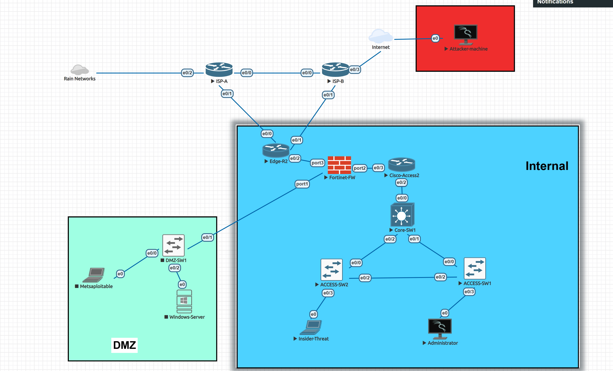

# Phase 2: Low-Level Design (LLD) & IP Addressing Architecture

## 1. Executive Summary
Phase 2 expands the foundational multi-vendor EVE-NG security lab into a multi-homed enterprise architecture. This phase implements dual-ISP BGP edge routing with deterministic failover, OSPF Area 0 internal route propagation, an isolated DMZ segment behind a FortiGate firewall operating under evaluation license constraints, and a three-perspective threat model intentionally maintained in an unhardened state for offensive testing prior to Phase 4 hardening.

---

## 2. Topology Overview

---

## 3. Network Segmentation & IP Addressing Plan

| Security Zone / Link | Subnet / CIDR | Gateway / Local IP | Connected Nodes & Interfaces | Role & Notes |
| :--- | :--- | :--- | :--- | :--- |
| **DMZ Segment** | '192.168.200.0/24' | '192.168.200.1' ('Fortinet-FW port1') | 'DMZ-SW1' ('e0/1' uplink), 'Metasploitable' ('192.168.200.10'), 'Windows-Server' | Isolated target zone for perimeter vulnerability testing |
| **Internal Core & Access** | '192.168.50.0/24' | 'Core-SW1' / 'Cisco-Access2' | 'ACCESS-SW1', 'ACCESS-SW2', 'Kali-administrator' (Admin/Automation), 'Insider-Threat' | Enterprise internal LAN segments |
| **FW-to-Core Transit** | '10.202.202.0/30' | '10.202.202.1' ('Fortinet-FW port2') | 'Fortinet-FW (port2)' <-> 'Cisco-Access2 (e0/3)' | Internal OSPF Area 0 peering & management GUI access |
| **Edge-to-FW Transit** | '10.100.100.0/30' | '10.100.100.1' ('Edge-R2 e0/2') | 'Edge-R2 (e0/2)' <-> 'Fortinet-FW (port3)' | Perimeter transit link between edge router and firewall |
| **Edge-to-ISP-A Link** | '10.0.0.0/30' | '10.0.0.1' ('ISP-A e0/1') | 'Edge-R2 (e0/0 - 10.0.0.2)' <-> 'ISP-A (e0/1 - 10.0.0.1)' | Primary eBGP transit link |
| **Edge-to-ISP-B Link** | '10.0.0.4/30' | '10.0.0.5' ('ISP-B e0/1') | 'Edge-R2 (e0/1 - 10.0.0.6)' <-> 'ISP-B (e0/1 - 10.0.0.5)' | Backup eBGP transit & external attacker ingress |
| **ISP-A Home Bridge** | '192.168.8.0/24' | '192.168.8.1' ('homerouter.cpe') | 'ISP-A (e0/2)' <-> 'Rain Networks' (Local Home Bridge) | Preferred internet breakout when operating locally |
| **ISP-B External Cloud** | '192.168.53.0/24' | '192.168.53.2' | 'ISP-B (e0/3)' <-> 'Internet' Cloud <-> 'Attacker-machine' | Secondary internet breakout & external Kali attacker path |

---

## 4. Routing & Traffic Engineering Architecture

### 4.1 Multi-ISP BGP Design ('Edge-R2' <-> 'ISP-A' & 'ISP-B')
* **Primary Path Preference ('ISP-A'):** Configured BGP path attributes (Weight) on 'Edge-R2' to deterministically prefer routes learned via 'ISP-A' ('10.0.0.1' -> '192.168.8.1'), optimizing local bandwidth when operating from home.
* **Automated Failover ('ISP-B'):** Peered 'Edge-R2' ('Ethernet0/1') with 'ISP-B' ('10.0.0.5') as a secondary transit provider. When 'ISP-A' becomes unreachable (simulated by shutting down 'Ethernet0/0'), BGP tears down the '10.0.0.1' neighbor adjacency and converges outbound traffic through 'ISP-B' ('192.168.53.2') with zero packet loss.

### 4.2 Dynamic Internal Routing (OSPF Area 0) & Static Routes
* **OSPF Area 0:** Configured across 'Fortinet-FW (port2)' and internal Cisco nodes ('Cisco-Access2', 'Core-SW1') to dynamically propagate internal networks and the DMZ subnet ('192.168.200.0/24').
* **Route Redistribution & Loop Prevention:** Controlled static-to-OSPF redistribution and tuned administrative distances between 'Edge-R2' and 'Fortinet-FW' to prevent routing loops across the '10.100.100.0/30' transit link.

---

## 5. FortiGate Evaluation Constraints & Policy Engineering

### 5.1 Troubleshooting Licensing & Packet Drops
During initial end-to-end ping tests from internal segments toward the internet, packets traversing 'Fortinet-FW' were silently dropped. Packet flow diagnostics ('diag debug flow') revealed evaluation license enforcement restrictions. Activating the evaluation license restored forwarding but enforced strict hardware and software ceilings:
1. **3-Port Hardware Limit:** Restricted physical/logical interfaces strictly to 'port1' (DMZ), 'port2' (Internal-Access), and 'port3' (Edge-Transit).
2. **3-Policy Limit ('vdom-max = 3'):** Required consolidating all security rules into stateful interface-pair policies ('DMZ-Segment <-> Edge-Transit', 'Internal-Access <-> DMZ-Segment', and 'Internal-Access <-> Edge-Transit').
---

## 6. Three-Perspective Threat Model & Unhardened Baseline

The lab is intentionally maintained in an **unhardened state** (broad service allowances, legacy protocols enabled, and default credentials retained on non-admin endpoints) to establish an offensive baseline prior to Phase 4 hardening:

1. **External Threat ('Attacker-machine'):** Kali Linux node positioned outside the perimeter behind the 'Internet' cloud via 'ISP-B' to test edge ACLs, NAT exposure, and DMZ isolation from an external adversary perspective.
2. **Insider Threat ('Insider-Threat'):** Connected to 'ACCESS-SW2' with default credentials left intact (while admin accounts on 'Kali-administrator' and 'Fortinet-FW' were hardened with custom credentials) to simulate credential abuse and lateral movement from a compromised internal host.
3. **Authorized Admin ('Kali-administrator'):** Connected to 'ACCESS-SW1' for firewall GUI management ('https://10.202.202.1'), CLI troubleshooting, and Phase 3 automation.

---

## 7. Verification & Failover Evidence

### 7.1 FortiGate 3-Port Policy Architecture ('10.202.202.1')

### 7.2 Primary Path Routing via ISP-A ('192.168.8.1')

### 7.3 Simulated Primary Link Outage ('Edge-R2' BGP Adjacency Flap)

### 7.4 Automated BGP Failover via ISP-B ('192.168.53.2')

---

## 8. Phase 3 Roadmap (Next Steps)
* **SSH Automation:** Programmatic SSH access from 'Kali-administrator' to all multi-vendor network nodes ('Edge-R2', 'Fortinet-FW', 'Core-SW1', 'Cisco-Access2').
* **Python Automated Backups:** Building Python scripts (Netmiko/Paramiko) to execute scheduled, timestamped configuration backups across all routers, switches, and firewalls, alongside configuration parsing and health checks.
* **'tmux' Telemetry Dashboard:** Centralized multi-pane terminal dashboard for real-time node monitoring.